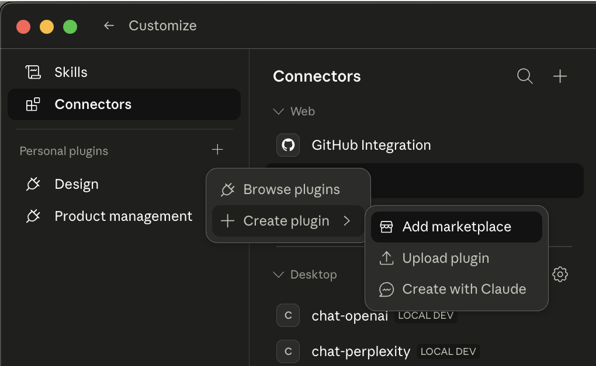
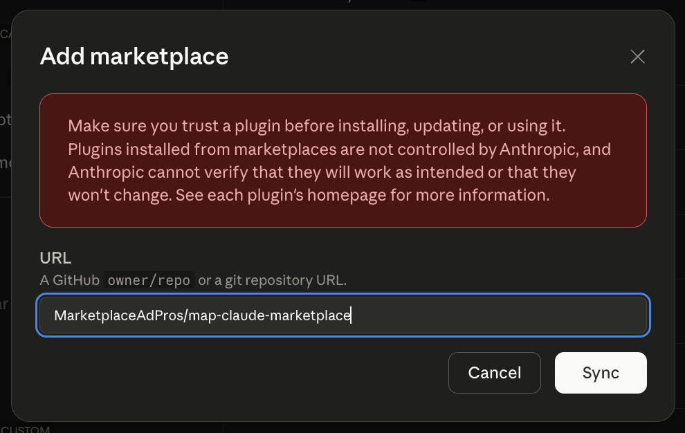

# Marketplace Ad Pros — Claude Plugins

Official Claude plugins from [Marketplace Ad Pros](https://marketplaceadpros.com?ref=github-map-claude-marketplace) for managing advertising and selling on Amazon.

## Plugins

| Plugin | Path | Description |
|--------|------|-------------|
| **Marketplace Ad Pros for Amazon** (`marketplace-ad-pros`) | `plugins/amazon/` | Amazon Ads analysis and optimization, Seller/Vendor Central insights, listing audits, inventory and launch playbooks — 13 skills |

## Install

### Claude Desktop

1. Open Claude Desktop and go to **Customize** (bottom-left).
2. Next to **Personal plugins**, click the **+** button.
3. Select **Create plugin** > **Add marketplace**.



4. Enter `MarketplaceAdPros/map-claude-marketplace` as the URL and click **Sync**.



5. The Marketplace Ad Pros plugin and its skills will be available in your plugins list.

### Claude Code

```bash
/plugin marketplace add MarketplaceAdPros/map-claude-marketplace
/plugin install marketplace-ad-pros@map-claude-marketplace
```

### Development / Testing

Load a plugin locally:

```bash
claude --plugin-dir ./plugins/amazon
```

## What's Included

Each plugin bundles:
- **Skills** — contextual guides Claude loads when relevant (campaign analysis, optimization strategy, inventory insights)
- **MCP server config** — auto-connects to the Marketplace Ad Pros API so tools are available immediately
- **No code to run** — plugins are documentation and configuration only; all logic runs server-side via MCP

## Prerequisites

A [Marketplace Ad Pros](https://marketplaceadpros.com?ref=github-map-claude-marketplace) account with your Amazon Advertising and/or Selling Partner accounts connected. See the [integration guide](https://marketplaceadpros.com/integrations/?ref=github-map-claude-marketplace) to get started.

## License

MIT
